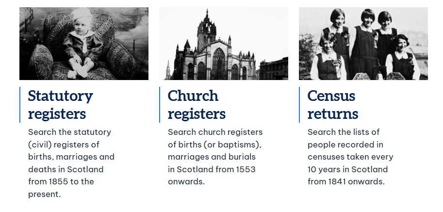

# Scotland's People guide — screenshot checklist

The page `how-to-use-scotlands-people-scottish-genealogy.html` contains six styled screenshot placeholders. Add your own screenshots in `img/` using the filenames below. On each `<figure class="scots-screenshot" data-screenshot="...">`, replace only the `<div class="scots-screenshot-placeholder">...</div>` block with an image like:

```html

```

The figure's existing caption should remain. Use the actual image dimensions for `width` and `height` to minimise layout shifts. Do not include screenshots until you have obtained them; the placeholders are intentional and no missing image links are included in this package.

| # | Filename in `img/` | What to capture | Where it appears |
|---|---|---|---|
| 1 | `scotlands-people-record-categories.png` | Search the records landing screen showing statutory, church, census and other categories. | Introduction / what the website does |
| 2 | `scotlands-people-search-results.png` | Historical search results with year/district and view-image or order options, including credit information if visible. | Free searches, credits and certificates |
| 3 | `scotlands-people-refine-search.png` | Refine search name-matching choices — fuzzy, begins-with, wildcard — with the field labels visible. | Six-step search workflow |
| 4 | `scotlands-people-record-viewer.png` | A suitable historical register entry in the viewer with reference / relevant controls visible. | Reading the original record |
| 5 | `scotlands-people-church-registers-search.png` | Church register search fields showing church denomination and dependent county/parish or congregation filters. | Pre-1855 church records |
| 6 | `scotlands-people-census-search.png` | Census form with the other person's forename search option (or a non-identifying results list). | Census and valuation rolls |

**Capture guidance:** use full-width, legible desktop captures, ideally around 1200–1600 pixels wide; crop away browser tabs and unrelated UI. Keep consistent spacing and avoid fine text becoming unreadable. Use original screenshots, check Scotland's People image-reuse/licensing conditions before reproducing any paid record image, and obscure account data, names of living individuals and any personally identifiable details. The website may update its layout over time; prefer the field names visible when you add each screenshot.

**SEO after adding images:** provide descriptive factual alt text (not repeated keywords), use reasonably compressed WebP or PNG/JPEG images, add actual width/height and keep lazy loading below the fold. The page's Open Graph image currently uses the existing site logo until a dedicated suitable graphic is available.
